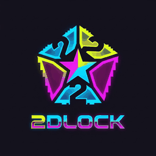

<p align="center">
  
</p>

# ⚽ 2Dlock — Domina il campo. Riscrivi la partita.

**2Dlock** è un gioco di calcio 2D ispirato all'energia degli anime calcistici: partite ad alta intensità, stili di gioco distintivi, abilità spettacolari e risvegli capaci di ribaltare il risultato. Non basta correre verso la porta: devi leggere l'azione, scegliere il momento giusto e trasformare ogni possesso in un'occasione.

Il progetto è realizzato in **HTML5, Canvas, CSS e JavaScript** e può essere giocato direttamente nel browser oppure tramite l'app desktop Windows basata su Electron.

> **Versione del gioco:** V7.7.23 TEST · **Desktop/updater:** 3.0.4  
> [⬇️ Scarica l'ultima versione per Windows](https://github.com/pinzagliapablo-svg/2dlock-desktop/releases/latest) · [📦 Tutte le release](https://github.com/pinzagliapablo-svg/2dlock-desktop/releases)

---

## 🔥 Entra in campo

### ⚽ Partite veloci e sfide tattiche
Gioca partite locali contro bot, costruisci le azioni con passaggi e dribbling, strappa il pallone agli avversari e cerca la conclusione perfetta. La modalità Ranked 5v5 propone matchmaking locale contro bot, difficoltà legata al rank e progressione competitiva.

Il menu LAN in browser include una preview delle schermate host, join e lobby; le connessioni LAN reali richiedono il bridge della versione desktop.

### 🧬 Style Lab — scegli la tua arma
Gli **Stili** definiscono le abilità del tuo giocatore. Ogni stile ha una propria identità, mosse C/X/V e un'abilità di Awakening: dalle accelerazioni e dai tiri speciali fino a dribbling tecnici, finte e tecniche difensive.

Tra gli stili disponibili trovi, per esempio, **Kaiser**, **Japan's Treasure**, **Zombie**, **Lazy Genius**, **Destroyer**, **Egoist**, **Demon** e altri ancora. Completa le missioni di **Mastery** per puntare a ricompense speciali.

### ✨ Flow Lab — attiva il tuo Flow
I Flow aggiungono un'identità e un vantaggio speciale al tuo stile di gioco. Scegli quello adatto al tuo modo di giocare e sfrutta l'effetto giusto nel momento decisivo.

### 🎰 Gacha, rarità e ricompense
Usa il Gacha per ottenere Stili e Flow, prova i **Lucky Spin** e punta alle categorie più rare. Il sistema distingue la **rarità della categoria** dalla probabilità individuale di ogni elemento; i bonus di target e i sistemi di pity completano la progressione. Le ricompense Mastery restano separate dal pool normale.

### 🌹 Abilità, VFX e momenti da ricordare
Ogni partita è accompagnata da effetti visivi dedicati: rose blu e scie energetiche di Kaiser, reveal distinti per Stili e Flow, banner goal e **ANKLE BREAKER!** quando riesci a superare un difensore. Le celebrazioni, i replay e gli effetti del pallone rendono ogni azione importante.

### 🍁 EGOIST AUTUMN FEST — Battle Pass e missioni a rotazione
Il Battle Pass stagionale Autumn include ricompense Free e Premium distribuite sui livelli, cinque missioni settimanali con reset il lunedì e missioni normali Egoist giornaliere con reset ogni 24 ore. Le ricompense cosmetiche del Pass non possono essere vendute; dopo aver completato tutti i livelli e riscattato le ricompense disponibili, il ciclo può essere riavviato dall'apposito pulsante.


### 🏟️ Stadi e personalizzazione
Scegli tra stadi diversi e personalizza l'esperienza con skin del pallone, effetti di esplosione goal e altre ricompense estetiche. La HUD delle abilità resta in una rail laterale compatta, così i comandi sono leggibili senza coprire il campo.

### 🛠️ QoL e impostazioni
- Pausa durante la partita con `P` o `ESC`, riavvio rapido con `R` e toggle audio con `M`.
- HUD con tasti, stato, cooldown e risorse delle abilità.
- Possibilità di personalizzare i comandi e le impostazioni disponibili.
- Interfaccia multilingua: English, Italiano, Français ed Español.
- Salvataggi locali persistenti, indipendenti dalla cartella d'installazione.

---

## 🖥️ Giocare su Windows

1. Apri la pagina delle [ultime release](https://github.com/pinzagliapablo-svg/2dlock-desktop/releases/latest).
2. Scarica `2Dlock-<version>-x64.exe).
3. Avvia l'installer e segui i passaggi.

L'app desktop controlla gli aggiornamenti dopo l'avvio e poi periodicamente. Quando è disponibile una release compatibile, il pannello in-game permette di scaricarla e installarla. **Chi usa una build desktop precedente al collegamento del pannello di aggiornamento potrebbe dover installare manualmente una versione aggiornata una prima volta.**

Il gameplay locale non richiede un server online; per scaricare aggiornamenti serve una connessione Internet. Una build non firmata può mostrare un avviso di Windows SmartScreen.

---

## 💻 Avvio in sviluppo

**Prerequisiti:** Windows 10/11 x64 e Node.js 20 o superiore.

```bash
npm install
npm start
```

Per controllare la sintassi dei file di supporto:

```bash
npm run check
```

Per creare l'installer Windows in locale:

```bash
npm run dist:win
```

In alternativa, su Windows puoi usare `AVVIA_DEV.bat` per avviare in sviluppo o `CREA_EXE.bat` per creare l'installer nella cartella `dist`.

---

## 🚀 Pubblicare un aggiornamento

Il repository usa **GitHub Actions** per compilare e pubblicare l'installer Windows e i file necessari all'auto-updater.

1. Aggiorna `index.html`, inclusi titolo, metadati, contratto di manutenzione e changelog del gioco.
2. Incrementa la versione desktop in **entrambi** `package.json` e `package-lock.json` (per esempio `3.0.2` → `3.0.4`).
3. Fai commit e push su `main` quando sei pronto a pubblicare.
4. Il workflow esegue i controlli, crea la release `vX.Y.Z`, compila l'installer e carica `.exe`, `.blockmap` e `latest.yml`.

**Importante:** ogni nuova release deve avere una versione desktop mai pubblicata prima. Se il tag esiste già, il workflow si ferma intenzionalmente per evitare di sovrascrivere una release precedente.

Per ricostruire una release esistente, apri **Actions → Build and publish 2Dlock for Windows → Run workflow** e specifica il tag esatto.

---

## 💾 Salvataggi e dati

I salvataggi dell'app desktop sono conservati in `%APPDATA%\\2Dlock`, al di fuori della cartella d'installazione. Un normale aggiornamento non dovrebbe cancellarli.

---

## 📌 Informazioni sul progetto

- **Gioco:** 2Dlock — calcio 2D con stili, Flow e abilità.
- **Build corrente:** V7.7.23 TEST.
- **App desktop:** Electron per Windows (3.0.4).
- **Gameplay:** locale contro bot; gli aggiornamenti automatici richiedono Internet.
- **Release:** [GitHub Releases](https://github.com/pinzagliapablo-svg/2dlock-desktop/releases).

2Dlock è un progetto indipendente e non ufficiale, ispirato all'estetica e all'intensità degli anime calcistici; non è affiliato a eventuali titolari di opere o marchi citati.
